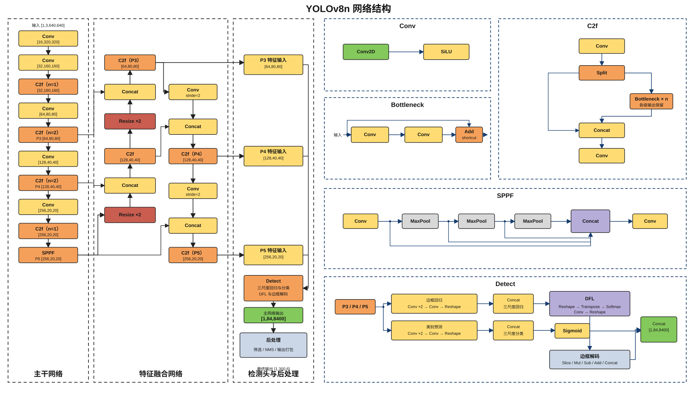

# YOLOv8n 模型与算子实现情况

## 1. 模型概况

| 项目 | 内容 |
|---|---|
| 模型 | Ultralytics YOLOv8n 8.4.92 |
| 格式 | ONNX，opset 13，FP32 |
| 输入 | `images [1,3,640,640]` |
| 主网络原始预测 | `[1,84,8400]`：4 个边框坐标、80 个类别分数 |
| 官方后处理输出 | `output0 [1,300,6]`：`x1, y1, x2, y2, score, class` |
| ONNX 节点 | 共 408 个：主网络 260 个，官方 NMS 后处理 148 个 |

ONNX 会把 C2f、SiLU 等网络模块展开成多个基础节点，因此 ONNX 节点数不等于需要实现的
NPU kernel 数量。NPU 主要负责处理大张量的计算原语，小规模 shape 和控制操作可留在 CPU。

本文的“实例数”和“Dayan 分配”均按原始 ONNX 节点统计。运行时子图融合不会修改原始
模型，因此被融合的 `Sigmoid`、`Mul` 仍会计入这两列；实际调度次数另行说明。

## 2. YOLOv8n 网络结构

| 部分 | 主要结构 | 作用 |
|---|---|---|
| Backbone | 多组 `Conv + C2f`，末尾为 `SPPF` | 逐级下采样并提取图像特征 |
| Neck | `Upsample、Concat、C2f` 和 stride-2 `Conv` | 融合浅层细节与深层语义，生成 P3、P4、P5 |
| Head | P3、P4、P5 三个尺度的 Detect 分支 | 分别预测边框和类别，经 DFL 解码后生成 8400 个候选 |
| 后处理 | 置信度筛选、NMS、结果打包 | 输出最多 300 个检测框 |

`C2f` 是复合模块，导出到 ONNX 后会展开为 `Conv/SiLU、Split、Add、Concat`。
P3、P4、P5 分别对应输入的 1/8、1/16、1/32 尺度，即 `80×80`、`40×40`、`20×20`。

## 3. 算子需求与实现情况

### 3.1 网络结构

下表中的实例数仅统计主网络原始预测部分中处理大张量的节点。

| 所需算子 | 实例数 | Dayan 分配 | 用途 |
|---|---:|---:|---|
| Conv2D | 64 | 64 | 特征提取、下采样、检测头、DFL 投影 |
| Sigmoid | 58 | 58 | 57 个属于 SiLU 模式，1 个计算分类概率 |
| Mul | 58 | 58 | 57 个属于 SiLU 模式，1 个用于 stride 缩放 |
| Add | 7 | 7 | C2f 残差和边框解码 |
| Sub | 1 | 1 | 边框解码 |
| Split | 8 | 8 | C2f 通道分支 |
| Concat | 17 | 17 | C2f、特征融合和预测拼接 |
| MaxPool2D | 3 | 3 | SPPF 池化 |
| Resize | 2 | 2 | Neck 两次最近邻上采样 |
| Slice | 2 | 2 | DFL 边框解码 |
| Transpose | 1 | 1 | DFL 维度变换 |
| Softmax | 1 | 1 | DFL 分布归一化 |

主网络中的 57 组 `Sigmoid(x) + Mul(x, Sigmoid(x))` 会被 Dayan EP 自动识别，分别以
一次 `silu_f32` 执行。因此表中仍是 58 个 Sigmoid 和 58 个 Mul，但实际激活计算为
57 次 `silu_f32`、1 次独立 `sigmoid_f32` 和 1 次独立 `kernel_mul_fp32`。主网络表中
222 个 Dayan 原始节点对应 165 个运行时执行单元。

SiLU 融合按普通算子口径验证：`silu_f32` 直接数值测试，以及只包含
`Sigmoid + Mul` 的 ONNX 小图融合、分配和 CPU/Dayan 输出对比；无需为此重复运行完整网络。

除 SiLU 融合子图外，其余 Dayan 节点仍基本独立执行 H2D、kernel launch 和 D2H，因此尚不
等于整个主网络都在 NPU 内连续执行。

### 3.2 官方后处理

| 所需算子 | 实例数 | Dayan 分配 | 用途 |
|---|---:|---:|---|
| Transpose | 6 | 6 | 1 个 FP32 预测张量和 5 个 INT64 索引转置 |
| Slice | 8 | 6 | 4 个 FP32、2 个 INT64 切片；2 个零宽分支留 CPU |
| ReduceMax | 1 | 1 | 扫描 `8400×80` 个分数，取得每个候选的最高类别分数 |
| ArgMax | 1 | 1 | 扫描 `8400×80` 个分数并生成 INT64 类别编号 |
| Greater | 1 | 0 | CPU 比较 8400 个最高类别分数与置信度阈值 |
| NonZero | 4 | 0 | CPU 扫描 BOOL mask 并生成动态 INT64 候选索引 |
| GatherND | 4 | 3 | 两个 FP32 和一个 INT64 节点由 Dayan 执行，空张量分支留 CPU |
| Div | 1 | 1 | 边框缩放 |
| Mul | 3 | 2 | 两个 FP32 张量节点由 Dayan 执行，一个控制节点留 CPU |
| Add | 1 | 1 | 添加类别偏移 |
| NonMaxSuppression | 1 | 1 | 删除重叠检测框 |

官方模型共 408 个原始节点，实测 Dayan 分配 244 个、CPU EP 分配 164 个。Dayan 分配的
244 个原始节点中包含 57 组 SiLU 融合子图，因此实际为 187 个 Dayan 运行时执行单元；
原始 ONNX 节点数和 CPU EP 分配数不变。
